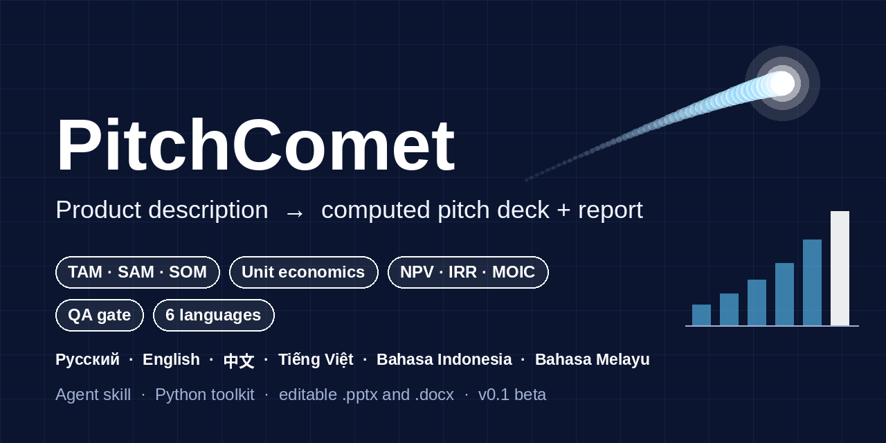
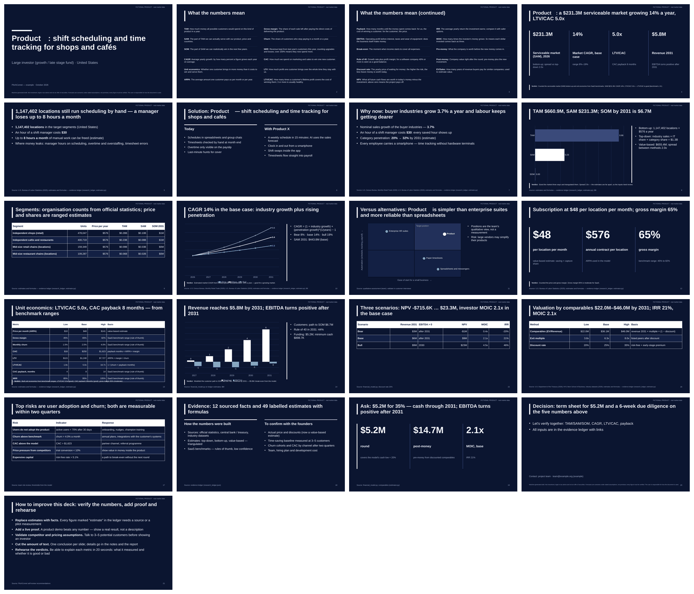
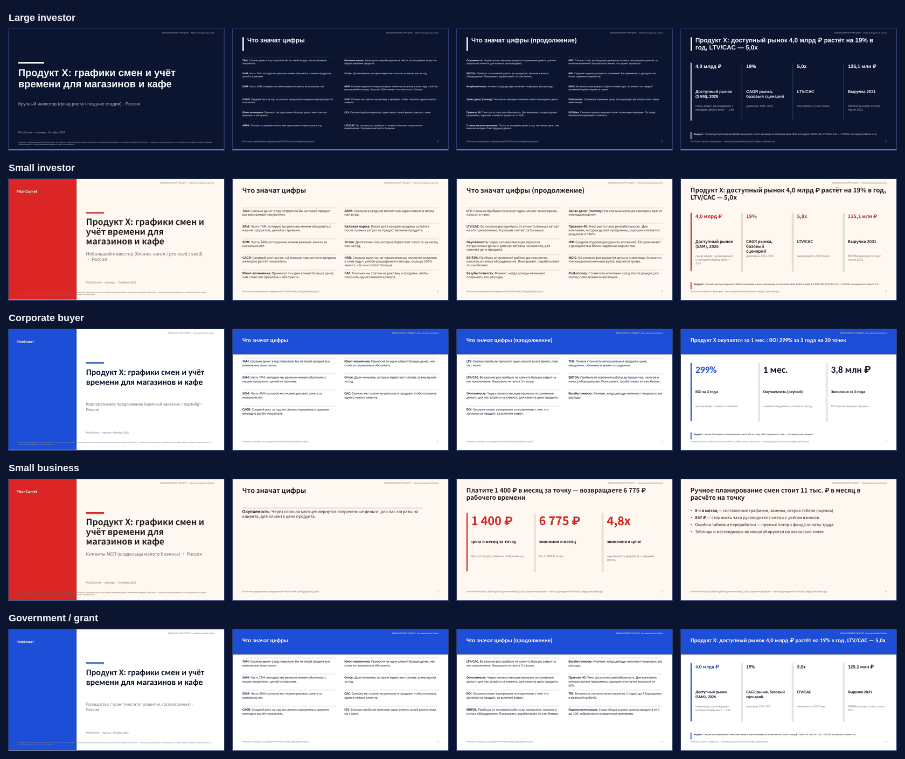
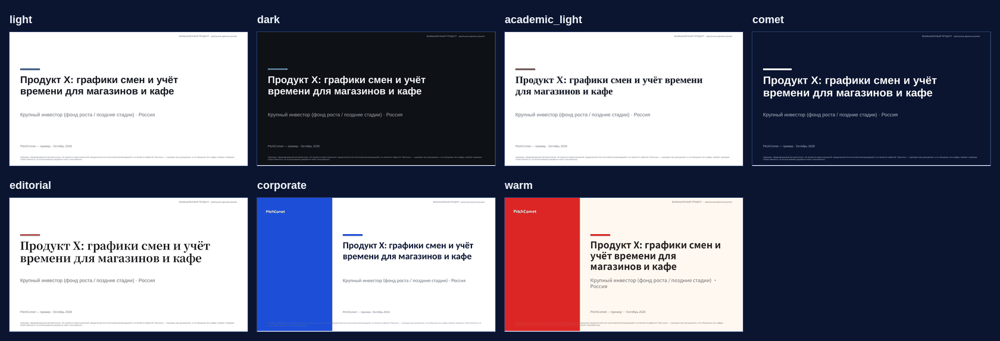
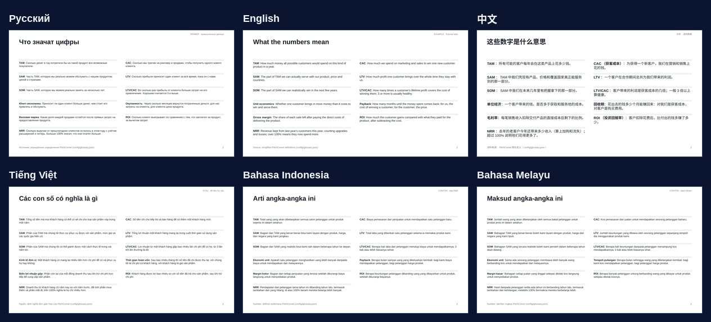
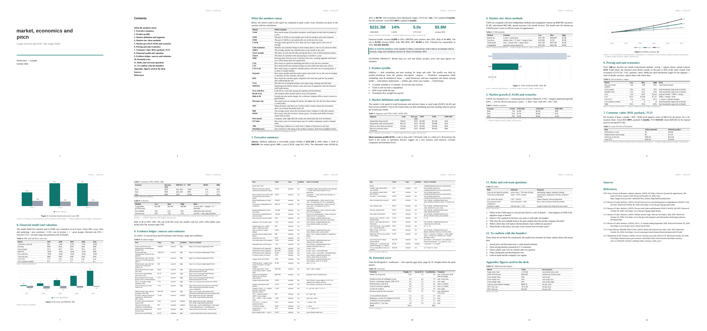

# PitchComet

[](CHANGELOG.md)
[](LICENSE)
[](pyproject.toml)
[](tools/tests)
[](#locales)
[](#agent-integration)



PitchComet это инструмент и набор инструкций. Он берёт короткое описание компьютерной программы
и делает из него готовую презентацию (.pptx) и аналитический отчёт (.docx). Инструмент сам
считает размер рынка, рост, цену, экономику одного клиента, финансовую модель и оценку
стоимости, даже когда у пользователя нет своих данных. Диаграммы встроены в документы и их можно
менять. Оба документа получают числа из одного источника. Программа поддерживает шесть языков.

* **Режим без начальных данных.** Сначала инструмент понимает что за продукт и кто покупатель.
  Дальше он собирает план поиска в интернете, список фактов со ссылками и считает размер рынка
  тремя способами. Потом идёт рост, сценарии, цена, экономика одного клиента, выгода для
  покупателя, финансовая модель на пять лет, доходность и оценка стоимости.
* **Проверка качества.** Инструмент не пропускает презентацию без размера рынка, роста и
  экономики клиента. Он также не пропускает пустые места вместо данных в любом из шести языков.
* **Пять шаблонов презентаций.** Для крупного инвестора, для небольшого инвестора, для крупной
  компании покупателя, для малого бизнеса и для государства. Каждый шаблон меняет порядок
  слайдов, длину, набор обязательных чисел, оценку, диаграммы, тон и финальный призыв.
* **Семь стилей оформления.** Светлый, тёмный, академический, комета, издательский, корпоративный
  и тёплый. Все поддерживают восточные шрифты.
* **Режим с готовыми данными тоже есть.** Если у пользователя уже есть свои цифры, он заполняет
  шаблоны входных данных и запускает основной конвейер.
* **Что значат числа.** Каждая презентация начинается со слайда, где простыми словами объяснены
  только те показатели, которые в ней есть. В отчёте есть такой же раздел. Проверка качества
  не пропускает документ, если какой то показатель не объяснён.
* **Готово для агентов.** Инструкция для программ помощников лежит в отдельном файле. Есть
  описания функций для вызова и простой сервер без внешних зависимостей.
* **Языки.** Русский, английский, китайский, вьетнамский, индонезийский и малайский. Профили
  рынков для России, США, Китая, Вьетнама, Индонезии и Малайзии.

Другие языки: [Русский](README.ru.md) · [简体中文](README.zh-CN.md)

## Галерея

Полная англоязычная презентация для инвестора в стиле комета, по описанию выше.



| Первые слайды пяти шаблонов | Семь стилей оформления |
|---|---|
|  |  |

Слайд со словарём на шести языках и сам отчёт.

| Словарь на шести языках | Отчёт (.docx) |
|---|---|
|  |  |

Все картинки это копии настоящих результатов из папки примеров. Команда
`python docs/make_assets.py` создаёт их заново.

## Шаблоны презентаций

| Название | Для кого | Стиль | Слайдов | Обязательные числа |
|---|---|---|---|---|
| `large_investor` | фонд роста, поздние стадии | comet | 15–20 | TAM, SAM, SOM, CAGR, LTV/CAC, Rule of 40, IRR, MOIC |
| `small_investor` | бизнес-ангел, pre-seed, seed | warm | 10–14 | TAM, SOM, CAGR, LTV/CAC, MOIC |
| `corporate` | крупный покупатель или партнёр | corporate | 9–13 | выгода клиента, общая стоимость владения, окупаемость |
| `smb` | владельцы малого бизнеса | warm | 6–9 | цена в месяц, экономия, окупаемость |
| `government` | грант, государственная программа | corporate | 11–15 | SAM, CAGR, выгода, общественный эффект |

Команда `--pattern auto` подбирает шаблон по описанию аудитории. Подробности в папке
[`patterns/`](patterns/README.md).

## Языки

| Язык | Пример денег | Даты | Ссылки на источники | Руководство по рынку |
|---|---|---|---|---|
| `ru` | `3,0 млрд ₽` | 20.10.2026 | ГОСТ Р 7.0.5 2008, сноски | `markets/ru.md` |
| `en` | `$3.0B` | October 20, 2026 | APA 7, можно Chicago | `markets/en.md` |
| `zh` | `30.0亿元` | 2026年10月20日 | GB/T 7714 2015, цифры | `markets/zh.md` |
| `vi` | `3,0 nghìn tỷ ₫` | ngày 20 tháng 10 năm 2026 | APA 7 | `markets/vn.md` |
| `id` | `Rp3,0 triliun` | 20 Oktober 2026 | APA 7 | `markets/id.md` |
| `ms` | `RM3.0 bilion` | 20 Oktober 2026 | APA 7 | `markets/my.md` |

Текст в режиме без начальных данных написан на русском и английском. Остальные языки получают
английский текст с правильным форматом чисел и дат для своего языка.

## Подключение к агентам

PitchComet это папка, которой программа помощник может пользоваться тремя способами. Каждый
способ запускает те же самые программы командной строки.

**1. Как навык.** Программы помощники, которые умеют читать папки навыков, читают файл
[`SKILL.md`](SKILL.md). Скопируйте папку в каталог навыков вашего помощника.

**2. Вызов функций.** Есть шесть функций с описаниями в формате JSON Schema.

```bash
python tools/agent_tools.py schemas                # список из имени, описания и параметров
python tools/agent_tools.py schemas --format mcp   # тот же список в формате для MCP
```

```json
{"name": "pitchcomet_build",
 "description": "Autonomous mode: brief + evidence ledger → computed TAM/SAM/SOM, CAGR, ... → deck.pptx + report.docx → QA.",
 "parameters": {"type": "object", "required": ["brief"],
   "properties": {"brief": {"type": "string"},
                  "pattern": {"enum": ["auto", "large_investor", "small_investor", "corporate", "smb", "government"]},
                  "themes": {"type": "array", "items": {"type": "string"}},
                  "render": {"type": "boolean"}}}}
```

Передайте этот список любой языковой модели, которая умеет вызывать функции, а сами вызовы
направьте в одну функцию.

```python
import sys; sys.path.insert(0, "tools")
from agent_tools import schemas, call_tool

tools = schemas()                       # отдайте это модели
result = call_tool("pitchcomet_build",  # когда модель вызывает функцию
                   {"brief": "examples/autonomous_shiftlyra/brief_en.json", "pattern": "auto"})
print(result["ok"], result["json"]["qa"])
```

Функции для вызова: `pitchcomet_plan`, `pitchcomet_build`, `pitchcomet_pipeline`, `pitchcomet_qa`,
`pitchcomet_metric`, `pitchcomet_glossary`. Подробные описания для каждого модуля лежат в файле
`tools/tools.json`.

**3. Сервер MCP.** Программа `tools/mcp_server.py` работает по протоколу Model Context Protocol
через стандартный ввод и вывод. Зависимостей нет. Добавьте её в любой клиент MCP.

```json
{"mcpServers": {"pitchcomet": {"command": "python", "args": ["/path/to/pitchcomet/tools/mcp_server.py"]}}}
```

**Командная строка.** Всё также работает как обычные команды. Поэтому агентам, которые умеют
только запускать команды, больше ничего не нужно.

## Инструменты

| Инструмент | Что делает |
|---|---|
| `tools/auto_pitch.py` | режим без данных, от описания до презентации с проверкой качества |
| `tools/product_profiler.py` | понимает категорию, покупателя, единицу, цену и стадию по описанию |
| `tools/market_definer.py` | коды классификации, сегменты, целевой клиент, план поиска и источники |
| `tools/research_ledger.py` | список фактов со ссылками, проверка и разрешение расхождений |
| `tools/estimator.py` | помеченные оценки, диапазоны, размер рынка, рост, цена и экономика клиента |
| `tools/pitch_story.py` | текст для каждого шаблона, заметки докладчика и приложение с числами |
| `tools/run_pipeline.py` | полный конвейер от рынка и финансов до документов и проверки качества |
| `tools/market_sizing.py` `tools/financial_model.py` `tools/scoring.py` | размер рынка, деньги и доходность, оценка |
| `tools/metrics_calc.py` | около пятидесяти показателей включая выгоду клиента и стоимость владения |
| `tools/build_docx.py` `tools/build_pptx.py` | сборка документов со встроенными диаграммами и стилями |
| `tools/qa_check.py` | проверка качества включая обязательный словарь и обязательные числа |
| `tools/glossary.py` | словарь простыми словами, находит показатели которые показаны в документе |
| `tools/agent_tools.py` `tools/mcp_server.py` | описания функций и сервер MCP |
| `tools/render_preview.py` `tools/citations.py` `tools/new_project.py` | картинки страниц, ссылки, создание проекта |

Подробности в [`tools/README.md`](tools/README.md). Описания схем в `tools/tools.json`.

## Структура папки

```
pitchcomet/
├── SKILL.md                      # инструкция для агента
├── README.md · README.ru.md · README.zh-CN.md · ADAPTING.md · CHANGELOG.md
├── deck_structure.md · style_guide.md · metrics.md · scoring_model*.md
├── config/  scoring_model.json · banned_phrases.json · themes.json · benchmarks.json · market_taxonomy.json · glossary.json
├── patterns/  patterns.json и пять руководств
├── markets/  руководства для рынков ru en zh vn id my
├── prompts/{ru,en,zh,vi,id,ms}/  поиск, вопросы, сюжет, текст слайдов, проверка
├── templates/{ru,en,zh,vi,id,ms}/
├── examples/  example_{ru,en,zh,vi,id,ms} и autonomous_shiftlyra
├── tools/  программы и тесты
├── docs/  картинки для галереи
└── LICENSE · CITATION.cff · SECURITY.md · CODE_OF_CONDUCT.md · CONTRIBUTING.md · pyproject.toml · .github/
```

## Принципы

* Для настоящих фактов нужна ссылка. Каждая оценка показывает свою формулу.
* Значения в `config/benchmarks.json` это примерные правила, и они так помечены.
* Числа приходят из инструментов, а не из текста. Одна мысль на слайд, заголовок это вывод.
* Примеры это вымышленные продукты, и они об этом говорят. Рыночные данные в примере без
  начальных данных настоящие и со ссылками.

## PitchComet создан на основе личного практического опыта вместе с ИИ-агентами, включая "Гигачат" и решения xAI

## Лицензия

MIT, подробности в файле [LICENSE](LICENSE).

## Disclaimer

PitchComet формирует черновики автоматически. Результат **не является юридической консультацией
и не является инвестиционной рекомендацией**. Каждую цифру перед использованием необходимо
проверить; ответственность за то, как используются документы и за достоверность цифр, полностью
несёт пользователь.